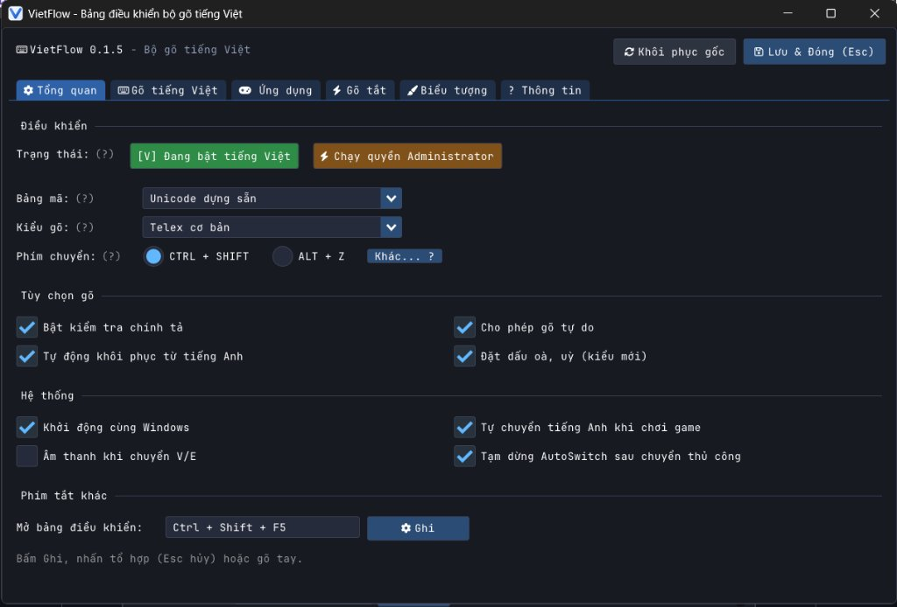

# VietFlow

Lightweight native Vietnamese input method for Windows.
Rust core engine and Win32 hook daemon, optional Text Services Framework (TSF) COM server, and an isolated Dear ImGui + DirectX 11 settings UI.

<p align="center">
  
</p>

Repository: [https://github.com/KienPC1234/VietFlow](https://github.com/KienPC1234/VietFlow)

## Key Features

- **Hybrid Input**: Native Text Services Framework (`vietflow_tsf.dll`) for zero-backspace composition in modern apps, plus a `WH_KEYBOARD_LL` hook with direct `CallNextHookEx` passthrough and held-key auto-repeat (WASD) for games and terminals.
- **Game Safe**: Automatic global hotkey locking in excluded apps (`Ctrl+Shift` / `Alt+Z`) and UWP/Xbox container process resolution via `ApplicationFrameHost.exe` (e.g., Roblox, CS2, Valorant).
- **Per-App Overrides**: Custom typing method, charset, key-injection mode, and macro access per executable.
- **Resource Footprint**: Always-on daemon uses ~2.4–2.9 MB private bytes (measured on Windows 11 x64/x86) and ~0% idle CPU. Settings UI runs in a separate process and releases its RAM/GPU resources when closed.
- **Smart English Restoration & AutoSwitch**: Phonotactic validation, configurable English keyword whitelist (e.g., `setup`, `texture`, `vector`), and bidirectional E/V AutoSwitch prevent mangling non-Vietnamese words.
- **Native Multi-Arch**: Static MSVC CRT builds (`/MT`, no VC++ Redistributable required) for x64, x86, and ARM64, with Per-Monitor V2 High-DPI vector UI.

## Feature Comparison

| Feature / Capability | VietFlow | EVKey | OpenKey | UniKey 4.6 RC2 |
| :--- | :--- | :--- | :--- | :--- |
| **Language & Architecture** | Rust core + Win32 host; C++ TSF & ImGui UI | C++ (Win32 API) | C++ (Win32 API) | C++ (MFC / Win32) |
| **Memory Safety** | Memory-safe Rust core (`unsafe` limited to FFI/Win32 & C++ UI/TSF) | C++ (manual memory management) | C++ (manual memory management) | C++ (manual memory management) |
| **Input Delivery Modes** | Hybrid: TSF TIP (Windows 10/11) + Low-Level Hook | Dual: Low-Level Hook + Classic IME (IMM32) | Low-Level Hook | Low-Level Hook |
| **Daemon Memory Footprint** | ~2.4–2.9 MB Private Bytes (idle daemon) | Not benchmarked in repo | Not benchmarked in repo | Not benchmarked in repo |
| **UI Isolation** | Separate-process DirectX 11 + ImGui (exits on close) | In-process Win32 Dialog | In-process Win32 Dialog | In-process MFC Dialog |
| **Game Movement (WASD)** | Direct passthrough + held-key auto-repeat | Heuristic passthrough | vDoNothing passthrough | Standard hook |
| **In-Game Hotkey Lock** | Automatic lock in excluded apps | Manual | None | None |
| **Per-App Profile Overrides** | Yes (Method, Charset, Injection, Macro) | Per-app E/V switch | Per-app E/V switch | None |
| **Browser URL Bar Conflict** | Native in TSF / NNBSP (`U+202F`) autocomplete guard | Temporary char workaround | NNBSP (`U+202F`) workaround | Standard backspace |
| **Windows on ARM (ARM64)** | Native ARM64, x64, x86 | x86 / x64 | x86 / x64 | x86 / x64 |
| **High-DPI Scaling** | Per-Monitor V2 vector UI (ImGui) | GDI custom draw | Win32 GDI controls | Win32 / MFC controls |
| **Dynamic Macro Tokens** | `@date`, `@time`, `@datetime`, `@clipboard`, `@tab`, `@newline`, CSV/TSV | Static text | Static text | Static text |
| **License** | Open Source (GPL-3.0-or-later) | Closed Source (freeware) | Open Source (GPLv3) | Closed Source (v4.6 RC2) |

## Layout

```
core/                  Vietnamese engine (Rust std, C ABI in ffi/vietflow_core.h)
ffi/                   Public C ABI header
platforms/windows/     Win32 hook daemon, tray host, config watcher, updater
platforms/windows_tsf/ Text Services Framework (TSF) TIP COM server (vietflow_tsf.dll)
ui_imgui/              Dear ImGui + DirectX 11 settings UI (C++20)
installer/wix/         Native WiX Toolset v5 MSI project
assets/                Application and tray icons
scripts/               Build, packaging, and release scripts
```

## Build

Requirements: Rust 1.75+, CMake 3.20+, Visual Studio Desktop C++ Build Tools (plus ARM64 MSVC build tools for `arm64`, and WiX Toolset v5 for `-Msi`).

```powershell
# Clone with submodules
git clone --recurse-submodules https://github.com/KienPC1234/VietFlow.git

# Test workspace
cargo test

# Build release (x64, static CRT -> dist\VietFlow-x64.exe)
.\scripts\build.ps1

# Build all architectures with native WiX MSI installers
.\scripts\build.ps1 -Arch All -Msi
```

## Donation

If VietFlow saves you time, you can support the project via VietQR (Techcombank `9978 5892 20` - HA TRI KIEN):

<p align="center">
  
</p>

## License

GPL-3.0-or-later. Core Vietnamese input algorithm is derived from UniKey (Pham Kim Long).
